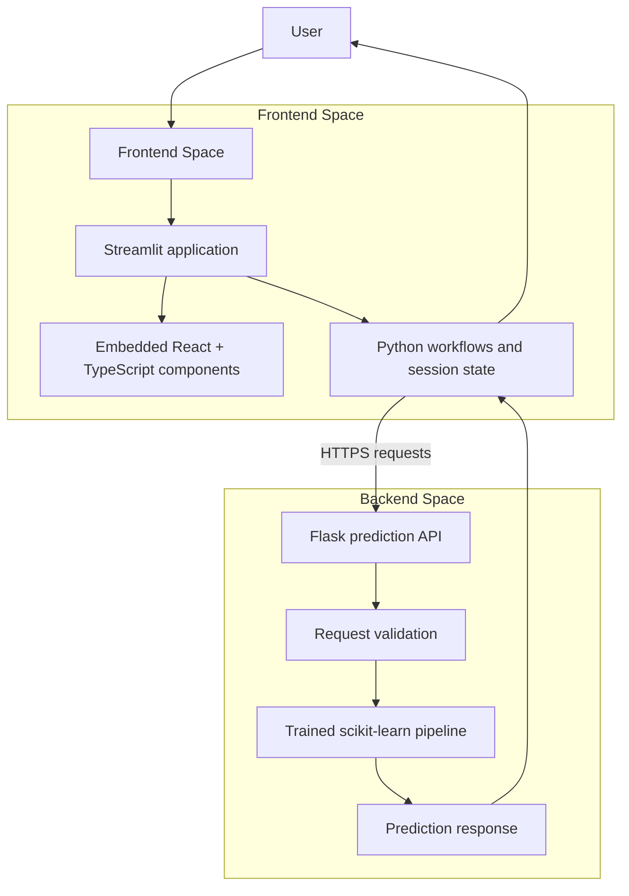

<div align="center">

# SuperKart | Retail Sales Intelligence

**A full-stack machine learning application for product-level retail sales forecasting, batch inference, and performance comparison.**

Built with Python, scikit-learn, Flask, Streamlit, React, and TypeScript.

[Explore the source](https://github.com/nscr45/SuperKart-Prediction/tree/superkart-2.0-stage-1) · [Backend Space](https://huggingface.co/spaces/sricharan451706/SuperKart-api-backend)

</div>

---

## Overview

SuperKart turns retail product and store attributes into sales forecasts through a simple, workflow-oriented application. Users can submit an individual product, process a dataset in bulk, or compare predicted outcomes across products.

The project combines an existing trained scikit-learn pipeline with a Flask inference API and a Streamlit application enhanced by embedded React and TypeScript components. The model remains on the backend; the frontend communicates with it through HTTP requests.

**The engineering focus:** separate model serving from the user interface, preserve the existing prediction pipeline, and provide practical workflows around inference rather than presenting a model in isolation.

## What it does

| Workflow | Capability |
|---|---|
| **Single-item forecasting** | Enter product and store attributes, request a prediction, and review the result with supporting business context. |
| **Batch inference** | Upload CSV, JSON, TXT, or PDF data, validate its structure, and generate predictions row by row. |
| **Product comparison** | Compare saved predictions using predicted sales and a descriptive Sales-to-MRP ratio. |
| **Export and review** | Download prediction outputs and retain completed results during the active Streamlit session. |
| **Service visibility** | Check whether the Flask API and its model are available before submitting inference requests. |

## Application architecture

The application is deployed as two independent Hugging Face Spaces. This keeps the model-serving layer separate from the user-facing application.



### Component responsibilities

| Layer | Technology | Responsibility |
|---|---|---|
| User interface | Streamlit | Application shell, navigation, forms, uploads, session state, and workflow orchestration |
| Interactive presentation | React + TypeScript | Embedded prediction presentation components |
| API layer | Flask | Health checks, input validation, model inference, and JSON responses |
| Machine learning | scikit-learn pipeline + joblib | Loads the trained pipeline and generates sales predictions |
| Data handling | pandas | Tabular input processing, validation, and result preparation |
| Deployment | Docker + Hugging Face Spaces | Independent frontend and backend runtime environments |

React is compiled into a production bundle during the frontend Docker build and embedded in Streamlit using Components v2. It is not deployed as a third service and does not call Flask directly.

## Repository layout

```text
SuperKart-Prediction/
├── backend/
│   ├── app.py                     # Flask inference API
│   ├── requirements.txt            # Backend dependencies
│   ├── Dockerfile                  # Backend container
│   └── README.md
│
├── frontend/
│   ├── app.py                     # Streamlit application entry point
│   ├── requirements.txt            # Frontend Python dependencies
│   ├── Dockerfile                  # Builds React and Streamlit runtime
│   ├── pyproject.toml
│   ├── components/                 # Single, batch, and comparison workflows
│   ├── config/                    # Application and model-input settings
│   ├── styles/                    # Streamlit styling
│   ├── utils/                     # API, file processing, and helpers
│   └── superkart_ui/
│       ├── prediction_reveal.py   # Streamlit React component bridge
│       └── frontend/              # React + TypeScript source
│
└── README.md
```

The trained model binary is maintained in the backend deployment environment. The frontend does not need a duplicate model file.

## Prediction input

The API expects the model's product and store attributes:

| Field | Description |
|---|---|
| `Product_Weight` | Product weight |
| `Product_Sugar_Content` | Product sugar/fat category |
| `Product_Allocated_Area` | Product display-area allocation |
| `Product_Type` | Product category |
| `Product_MRP` | Maximum retail price |
| `Store_Establishment_Year` | Store establishment year |
| `Store_Size` | Store size category |
| `Store_Location_City_Type` | Store location classification |
| `Store_Type` | Store format |
| `Product_Id` | Product identifier used for tracking and result presentation |

The API constructs a model input frame from the nine model features. Product ID is used for additional context and is not passed as a model feature.

## API

The Flask service exposes the following endpoints:

| Method | Endpoint | Purpose |
|---|---|---|
| `GET` | `/` | API status and endpoint information |
| `GET` | `/health` | Service health and model-loaded status |
| `POST` | `/predict` | Validate input and return a sales prediction |

### Example request

```bash
curl -X POST "$BACKEND_URL/predict" \
  -H "Content-Type: application/json" \
  -d '{
    "Product_Id": "FD123",
    "Product_Weight": 12.5,
    "Product_Sugar_Content": "Low Fat",
    "Product_Allocated_Area": 0.045,
    "Product_Type": "Dairy",
    "Product_MRP": 145.5,
    "Store_Establishment_Year": 2010,
    "Store_Size": "Medium",
    "Store_Location_City_Type": "Tier 2",
    "Store_Type": "Supermarket Type1"
  }'
```

A successful response includes the numeric prediction, status, derived features, and a compact input summary. Invalid or incomplete requests receive an error response.

## Local development

### 1. Backend

From the repository root:

```bash
cd backend
pip install -r requirements.txt
python app.py
```

The backend expects `superkart_complete_pipeline.joblib` in its working directory. Use the actual trained model artifact; a Git LFS pointer is not a substitute for the model binary.

### 2. Frontend

In a second terminal, from the repository root:

```bash
cd frontend
pip install -r requirements.txt

cd superkart_ui/frontend
npm install
npm run build

cd ../..
pip install .
streamlit run app.py
```

Configure the backend address with the `BACKEND_URL` environment variable. The frontend currently defaults to the deployed backend URL.

## Hugging Face deployment

The production setup uses two Docker Spaces:

1. **Backend Space:** copy the contents of `backend/` into the backend Space root. Ensure the actual model artifact is present there.
2. **Frontend Space:** copy the contents of `frontend/` into the frontend Space root. Do not add an extra enclosing `frontend/` directory.
3. In the frontend Space, set the `BACKEND_URL` variable to the backend Space's public URL.
4. Keep Hugging Face-specific Space metadata in each Space's own root README, not in the shared source repository README.

The frontend Dockerfile builds the React bundle and starts Streamlit on port `7860`.

## Design and implementation notes

- **Separation of concerns:** model inference and user interaction run in separate services.
- **Single model source:** the existing trained pipeline remains the source of predictions.
- **Validated requests:** the backend checks required fields and numeric input validity before inference.
- **Workflow-oriented interface:** single prediction, batch processing, and comparison are distinct user journeys.
- **Transparent interpretation:** Sales-to-MRP is used as a descriptive comparison ratio. It is not profit margin, a measure of model confidence, or a causal estimate.
- **Session-scoped results:** saved predictions are maintained in Streamlit session state and can be exported.

## Technology stack

**Python** · **scikit-learn** · **Flask** · **Streamlit** · **React** · **TypeScript** · **pandas** · **Matplotlib** · **Docker** · **Hugging Face Spaces**

---

<div align="center">

**SuperKart | From model inference to retail decision support**

A portfolio project demonstrating machine learning integration, API development, frontend engineering, data workflows, and multi-service deployment.

</div>
